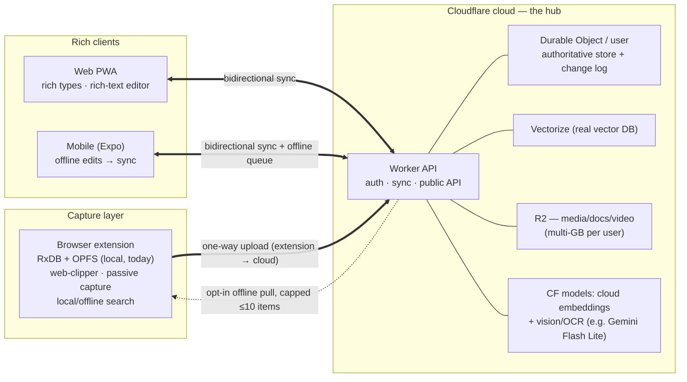
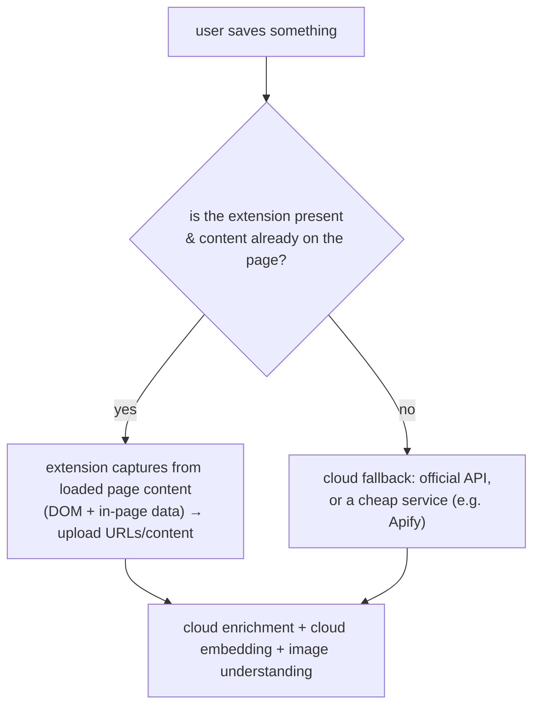
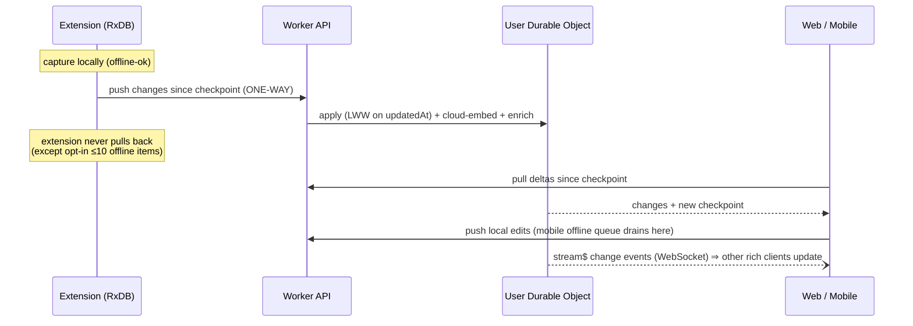

# Going Multiplatform — Cloud, Sync & Cross-Platform Apps

> **Status: proposal / target-state.** Unlike the rest of `docs/architecture/`, this page does
> **not** describe what exists today. It describes where Vibesearch is headed — a web app, mobile
> apps, a Cloudflare-backed cloud, live sync, server-side vector search, richer ingestion, and a
> public API — and the decisions made and still open. The companion as-built pages
> ([README](README.md), [backup-and-sync.md](backup-and-sync.md),
> [vector-store.md](vector-store.md), [embeddings.md](embeddings.md), [workers.md](workers.md))
> remain the source of truth for the current extension.
>
> **This revision folds in the owner's decisions** (see [Decisions](#decisions-resolved)). The
> headline shifts from the first draft: the **extension becomes a capture tool with one-way sync**,
> **web & mobile drop RxDB/OPFS**, and **local and cloud embeddings are deliberately decoupled**.

## The one-paragraph version

The **extension stays what it's best at: capturing**. It keeps its local RxDB + on-device
embeddings for offline search, and it pushes everything it gathers **one way, up to the cloud**.
The **cloud (all Cloudflare) is the hub** and the home of the richer product — real vector DB,
bigger models, rich content types, a rich-text editor, better search. The **web (a PWA) and the
mobile app (Expo)** are full clients that read and write the cloud and stay in sync with each
other; mobile can edit offline and reconciles when it reconnects. Local (extension) and cloud
embeddings are **independent and standardized within each domain**, so there's no cross-device
vector-compatibility problem to manage.

> *Owner's note, preserved:* "I know this day would come. I designed it myself a year ago for this
> moment." The schema's sync fields (`userId`, `serverVersion`, `updatedAt`, `deletedAt`,
> `deleted_items` tombstones) are deliberate, not accidental.

---

## Roles & data flow

The single most important picture. Note the **asymmetry**: the extension is upstream-only; web and
mobile are full peers around the cloud.

| Surface | Direction | Local data | Role |
| --- | --- | --- | --- |
| **Extension** | **→ cloud only** | full local (RxDB + OPFS) | Capture: web-clipper, passive page capture, bookmark/star gathering, offline search. Not full-featured. |
| **Web** | ↔ cloud | **none — pure server** (TanStack Query in-memory cache) | The rich product: all content types, rich-text editor, full cloud search. |
| **Mobile (Expo)** | ↔ cloud | offline-capable cache | Full client; offline additions/edits sync when online; share-sheet quick-save. |
| **Cloud** | hub | authoritative | Owns the canonical copy, vectors, media, enrichment, the public API. |

Two rules that fall out of this and matter everywhere downstream:

> **The extension is ephemeral-local.** On uninstall, its local data is **erased**. Recovery is
> only via the cloud copy or a saved JSON/Drive backup. So "syncing to the cloud" is also the
> extension's durability story.

> **Once data reaches the cloud, it propagates to every rich client.** All edits made on web or
> mobile sync to all other web/mobile devices. They do **not** flow back into the extension
> (except the small opt-in ≤10-item offline pull).

---

## Why this is closer than it looks

- **`search-core/` is already pure** — query language, hybrid ranking, embedding-text rules,
  contracts; no `chrome`, no DOM, no I/O. The same modules run in a React Native app **and inside
  a Cloudflare Worker**, so query parsing + ranking are identical on every surface.
- **The schema is already a sync schema.** `serverVersion` (monotonic server counter),
  `updatedAt`/`deletedAt`, and `deleted_items` tombstones are exactly the primitives a
  checkpoint-based sync needs — whether or not RxDB is the thing consuming them.
- **The Cloudflare footprint already exists** — Workers for metadata/sharing/media, the model
  mirrored to R2. We extend it; we don't start it.

> **RxDB stays in the extension only.** Web and mobile use the data layer best suited to them (see
> [Sync](#sync-one-way-up-bidirectional-across-the-cloud)). The schema primitives still travel; the
> RxDB *dependency* does not.

---

## The shape: one core, many shells

A monorepo (Bun workspaces + **Turborepo** — already on Bun). UI forks by platform; the core does
not.

| Layer | Package | Reused where |
| --- | --- | --- |
| **Shared** | `@vs/search-core` (pure: query lang · ranking · embedding-text) | extension · web · mobile · Worker |
| | `@vs/schemas` (item/folder/space types + sync fields) | everywhere |
| | `@vs/api-client` (typed cloud client) | web · mobile · extension |
| | `@vs/ui-web` (existing React components) | extension · web |
| **Shells** | `apps/extension` (MV3, today; RxDB + OPFS) | Chrome/Firefox |
| | `apps/web` (**TanStack Start** — Router + Query, SSR on Cloudflare Workers) | browsers |
| | `apps/mobile` (Expo / React Native) | iOS/Android |
| | `apps/api` (Cloudflare Workers) | the cloud hub |

There are still **two UI codebases** (DOM-React for extension + web; React Native for mobile) — RN
Web isn't worth forcing on a data-dense, keyboard-driven app. Everything below the view layer is
shared. **No `apps/desktop` for now.**

---

## The cloud brain (Cloudflare-native)

- **Vectorize** — the real vector DB. The cloud generates its **own** embeddings on ingest with a
  Cloudflare-hosted model (a "real" model, larger than the on-device one), and may chunk
  differently. Local extension vectors are never compared against cloud vectors — see
  [Embeddings](#embeddings-deliberately-decoupled).
- **Durable Object per user** — authoritative store (DO SQLite) + ordered change log + WebSocket
  change stream. This is the sync coordinator. D1/KV handle cross-user/global concerns (share
  registry, rate-limit counters).
- **R2** — media, PDFs, documents, video. **Budget for multi-GB per user**; large uploads use
  multipart; clients reference by URL and cache selectively (never mirror it all).
- **Queues** — async pipelines: enrichment, cloud embedding, image understanding/OCR,
  social-content fetch. Replaces the extension's in-browser alarms for the cloud path.
- **AI (Workers AI / AI Gateway)** — cloud embeddings, and **image-understanding models** (e.g.
  Gemini Flash Lite via AI Gateway, or Workers AI vision) that describe an image *and* extract its
  text in one pass — superseding a dedicated OCR model on the cloud side.
- **KV** — sessions/share metadata/rate-limit counters.

### Ingestion strategy — capture-first, APIs as fallback

To dodge expensive platform APIs, **prefer data the browser already has**:

The extension reads what the user's browser already loaded (no extra platform API call); only when
that's unavailable does the cloud fall back to an official API or a cheap scraper service. *(MV3
note: this is content-script/page-context extraction of already-rendered data, not privileged
network interception.)*

---

## Sync: one-way up, bidirectional across the cloud

Two distinct mechanisms, both built on the same schema primitives (`serverVersion`, `updatedAt`,
`deletedAt`, tombstones). Neither requires RxDB on web/mobile.

- **Extension → cloud (one-way).** The extension pushes; it does not pull (aside from the capped
  ≤10-item opt-in offline cache). When the user is on a paid plan, sync-up is default-on; on the
  free/no-account path, data stays local.
- **Web & mobile ↔ cloud (bidirectional).** Pull deltas since a checkpoint, push local changes,
  receive live updates over WebSocket. **Mobile queues offline edits** and drains them on
  reconnect. Conflict policy: **last-writer-wins by `updatedAt`** (the policy
  `mergeBackupSnapshot` already ships).
- **Client data layer (web/mobile).** A lightweight local-first state layer with offline
  persistence (lean: **Legend-State** or equivalent — works on both web and RN, backend-agnostic),
  *not* RxDB. The CF sync endpoint is the backend.

---

## Embeddings: deliberately decoupled

> **Resolved:** local and cloud embeddings are **independent**, each standardized within its own
> domain. There is no cross-domain vector comparison, so there is **no parity problem to solve.**

- **Extension (local):** keeps the on-device `mdbr-leaf-ir` (768-dim) for local/offline search
  only. Vectors live in OPFS, as today.
- **Cloud:** on ingest, re-embeds with a Cloudflare-hosted "real" model into Vectorize. Different
  model, possibly different dimension and chunking — that's fine, because cloud search only ever
  compares cloud vectors with cloud vectors.

The first draft's "embedding parity" risk is therefore **closed**: decoupling removes it by design.

---

## Search across platforms

One ranking brain (`search-core`), two indexes:

- **Extension (local):** FlexSearch keyword/fuzzy/phonetic + OPFS brute-force vectors, fused by
  `hybrid-ranking.ts`. Unchanged.
- **Cloud (web/mobile):** keyword + **fuzzy** + semantic, fused by the **same**
  `hybrid-ranking.ts` in a Worker, with `query-language.ts` parsing the same syntax. Fuzzy in the
  cloud is an **open implementation choice** (DO SQLite FTS5 + trigram/`spellfix1`, or running the
  pure-JS fuzzy matcher server-side, or a managed index) — see [Still open](#still-open). The
  requirement is firm: **fuzzy must work on the web.**

---

## Content types & ingestion

Most requested types already fit the `items` schema (`media[]` + `textContent` + `source`); the
rest are additive schema migrations. The **web** is where the rich types live; the extension need
not support them.

| Type | How it slots in |
| --- | --- |
| PDFs / documents | R2 blob + cloud text extraction → `textContent` → cloud-embed. Multipart upload for large files. |
| Videos / photos | R2 (multi-GB budget); images run through cloud image-understanding (content + OCR). |
| Social posts (Reddit / X / …) | Capture-first via extension; fallback official API / Apify; `source`/`likes`/`upvotes` exist. |
| Recipes | schema.org `Recipe` extraction in enrichment → structured fields. |
| Todo lists | A structured collection (the `flashcards` sibling pattern). |
| Rich text | Structured editor JSON (TipTap/Lexical) in a new `richContent` field **+ a plaintext projection** for search/embedding. **(Web/mobile only.)** |

---

## Identity, auth & accounts

- **Providers via Firebase Auth — yes.** Firebase brokers Google/Apple/email sign-in; the Worker
  verifies the Firebase-issued ID token (Google-signed JWT) statelessly against Google's public
  keys + `aud`. Tradeoff: a Google dependency (not CF-native), but the fastest route to Apple +
  Google + email. (Alternatives if you'd rather: Auth0/Clerk/Supabase Auth, or roll-your-own on
  Workers.)
- **Sessions:** Firebase ID tokens (JWT) verified per request; refresh handled by the Firebase
  client SDK. No server session store needed beyond optional KV for revocation lists.
- **Device management:** a device list with **per-device revoke** (required).
- **Account deletion & full export:** users can export everything or delete at any time (reuse the
  existing snapshot export).
- **Accounts are opt-in.** Extension is local & account-free by default; the cloud/web/mobile
  experience requires sign-in and de-emphasizes the local-only framing.

---

## Privacy & private spaces

> **Resolved model:** the web version also has **private spaces**. When a client syncs local
> private-space data up, the cloud stores it **only if the user has set up a private space in the
> web version**; otherwise that private data is **not synced** (it stays local). Cloud private
> spaces are **account/access-controlled and server-readable** (so cloud semantic search works) —
> not end-to-end encrypted.

- The extension's existing PBKDF2 local private spaces remain local; they only flow up into a
  matching cloud private space.
- Data is private/user-owned and never placed in public surfaces; only content the user explicitly
  saved is theirs to see. **Legal/DMCA posture is owner-managed and out of scope here.**
- **Region:** global Cloudflare is fine; no EU/residency pinning.

---

## Public API

REST (OpenAPI) on Workers, authenticated by per-user **scoped API keys** (hash-only storage — the
`vshr_owner_…` pattern). The surface mirrors the controllers (`items`, `folders`, `spaces`, `tags`,
search, import/export); the `router.ts` allowlist is effectively the spec. **Rate-limited**
(KV/DO counters) with abuse protection. `ShareSnapshotV1` is the export/import payload.

> **Security:** the sync endpoint and public API are network-exposed, multi-user surfaces — both
> **must** be authenticated. An unauthenticated sync endpoint would expose every user's library.

---

## Sharing

Unchanged in spirit, kept **simple**: a share is either **public or PIN-protected** (the existing
capability-URL model). **No real-time collaboration** — recipients **import** a share and keep
their own copy/edits in the web app. The public viewer does not change.

---

## Scope & sequencing

**In scope now: web (PWA) + mobile (Expo).** Desktop is deferred (Electron if ever). No OPFS / no
heavy offline engine on web — a PWA is the ceiling.

1. **Monorepo extraction** — `search-core`, `schemas`, `api-client` into packages; extension keeps
   working. Pure refactor.
2. **Cloud hub** — Worker API + per-user Durable Object + Firebase-token auth + the change-log/
   WebSocket sync. Wire the **extension's one-way upload** first (this also gives it cloud backup).
3. **Vectorize + cloud embeddings + image understanding** — cloud search server-side, reusing
   `hybrid-ranking`; settle the cloud fuzzy mechanism.
4. **Web app (PWA)** — reuse the React UI against the API; add rich types + rich-text editor.
5. **Mobile (Expo)** — RN UI on the shared core; share-sheet quick-save (hand off to app, process
   in background); offline edits + push notifications.
6. **Public API + richer ingestion** (capture-first, Apify fallback) — once the spine is stable.

---

## Decisions (resolved)

Captured from the owner's review. "Owner" = product decision; "Mine" = delegated to me.

| Area | Decision |
| --- | --- |
| **Scope** | Web + Expo mobile now. **No desktop** (Electron if ever). *(Owner)* |
| **Extension role** | Capture-only; **one-way sync up**; not full-featured; local data **erased on uninstall** (recover via cloud/JSON/Drive). *(Owner)* |
| **Reverse flow** | Opt-in "make web content offline in extension," **capped ≤10 at a time**. *(Owner)* |
| **Web/mobile storage** | **No RxDB, no OPFS.** Web = PWA + light cache; pick best-fit local layer (lean: Legend-State). *(Owner + Mine)* |
| **Embeddings** | Local (extension) and cloud **decoupled & standardized per domain**; cloud uses a real CF model. Re-embedding cost is acceptable. *(Owner)* |
| **Backend** | All Cloudflare. *(Owner)* |
| **Vector DB tenancy** | **Mine to design** for global scale — lean: shared Vectorize indexes with `userId` metadata filtering, sharded as volume grows. |
| **Authoritative store** | **Mine** — Durable Object per user (SQLite) + change log; D1/KV for global concerns. |
| **Image text/OCR (cloud)** | Use **image-understanding models** (Gemini Flash Lite via AI Gateway / Workers AI vision) — content + OCR in one. *(Owner)* |
| **Auth** | Firebase Auth (Google/Apple/email); verify ID tokens in Workers. **Per-device revoke.** Full export + account deletion. *(Owner)* |
| **Private spaces** | Exist in web; local private data syncs **only** into an existing cloud private space, else ignored; server-readable (not E2E). *(Owner)* |
| **Region/legal** | Global CF fine, no EU pinning; legal/DMCA owner-managed, out of scope. *(Owner)* |
| **Sharing** | Public **or** PIN-protected only; **no collaboration**; recipients import their own copy. *(Owner)* |
| **Tombstones** | **30-day** retention. *(Owner)* |
| **Ingestion** | **Capture-first** (read already-loaded page content); fallback official APIs / Apify. *(Owner)* |
| **Monetization** | Make it work first; some features become paid later. Paid plan ⇒ cloud sync default-on; free ⇒ local. *(Owner)* |
| **Push notifications** | Needed. *(Owner)* |
| **Rate limiting & observability** | Both required (API rate limits; Workers Analytics + error/lag metrics). *(Owner)* |
| **Monorepo** | Yes (Turborepo). *(Owner + Mine)* |

---

## Still open

Genuinely unresolved (or delegated and needing a concrete pick):

- **Cloud fuzzy search mechanism** — DO SQLite FTS5 + trigram/`spellfix1`, pure-JS fuzzy
  server-side, or a managed index. Requirement: fuzzy must work on web. *(Mine to prototype.)*
- **Rich-text concurrent edits** — LWW loses concurrent edits on a shared rich-text doc. Is
  whole-doc LWW acceptable, or is per-field/CRDT (Y.js) merge needed for the editor? *(Likely fine
  as LWW given no real-time collab — confirm.)*
- **Vectorize tenancy specifics** — namespace vs. metadata filter vs. index-per-shard, and the
  sharding plan at scale. *(Mine.)*
- **Per-account storage quotas / tiers** — given multi-GB libraries, where do free vs. paid caps
  sit? Video length/size cap; transcoding + thumbnails? *(Owner, later.)*
- **Initial/large sync strategy for new devices** — full vs. lazy (metadata first, bodies on
  demand). Lean: lazy, given online-first web/mobile.
- **Schema/API version lockstep** across independently-updating clients (esp. mobile) — versioned
  wire contract + compatibility window.
- **Existing-user upgrade moment** — silent opt-in backup vs. explicit account creation prompt.
- **Mobile specifics** — iOS background-sync limits; store-review posture (license/accounts).
- **API-key scope granularity** — read-only / per-space / full; rotation UX.

---

## Summary

| Requirement | Mechanism | Status |
| --- | --- | --- |
| Web app | Existing React UI as a **PWA** against the API; no RxDB/OPFS | in scope |
| Mobile (iOS/Android) | **Expo / RN** UI on the shared core; offline edits; share-sheet | in scope |
| Desktop | — | **deferred** |
| Extension | Capture tool; **one-way upload**; erased on uninstall; ≤10 offline pull | reshaped |
| Real vector DB | **Vectorize** (cloud); extension keeps local OPFS vectors | proposed |
| All-Cloudflare backend | Workers · Durable Objects · Vectorize · R2 (multi-GB) · Queues · AI · KV | proposed |
| Sync | Extension→cloud one-way; web/mobile↔cloud bidirectional (change log + WebSocket) | proposed |
| Embeddings | **Decoupled** local vs. cloud; cloud uses a real CF model | resolved |
| Image text/OCR | Cloud **image-understanding** model (content + OCR) | resolved |
| Social enrichment | **Capture-first**, fallback official API / Apify | resolved |
| Rich types (PDF/doc/video/recipe/todo/rich text) | R2 + cloud extraction + additive schema; web/mobile | proposed |
| Auth | **Firebase** (Google/Apple/email) verified in Workers; per-device revoke | resolved |
| Private spaces | Cloud private spaces; local private data syncs only into one | resolved |
| Public API | Workers REST/OpenAPI, scoped hashed keys, rate-limited | proposed |
| Identical relevance | `search-core` runs on every client **and** in the Worker | enabled by current design |
