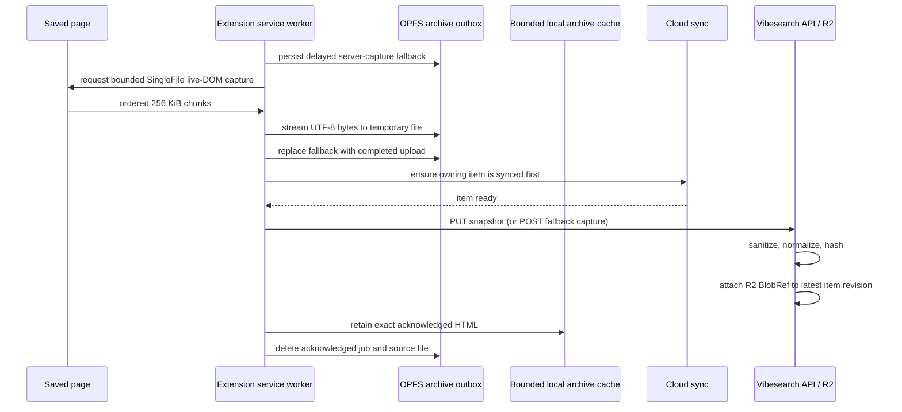

# Offline Page Archives

Vibesearch stores a durable, inert HTML snapshot for a saved web page so web and
mobile clients can preview it when the original site is unavailable. The
extension is the high-fidelity capture source; the Cloudflare API is the
sanitizer, fallback capturer, and R2 owner. The card View action fetches the
latest snapshot by item ID and renders it in the extension's right-side preview
sheet rather than embedding the live website.

Implementation: `src/content/page-archive-capture.ts`,
`src/services/archive-capture-session.ts`, `src/services/archive-outbox.ts`,
`src/services/archive-resource-url.ts`, and the archive handlers in
`src/workers/background.ts`.

## Save-to-preview flow

The delayed fallback is written before live capture starts. If Chrome terminates
the Manifest V3 worker midway, the next alarm can still ask the server to capture
the URL. A successful live capture replaces that intent atomically, so there is
only one newest archive job per item. A successful upload is not acknowledged
locally until the same bytes are safely copied into the bounded archive cache,
so turning the device offline after save does not break View. Server-captured or
cross-device archives are added to this cache after their first online preview.

## Live capture

`single-file-core` serializes the rendered DOM with scripts blocked. The wrapper
retains original resource hints for assets SingleFile cannot read under normal
page CORS, while preserving every usable embedded data URI. The API may complete
those retained references for snapshots no larger than 8 MiB. Larger documents
use a one-pass server rewrite and drop unresolved network references.

The feature performs page-context fetches only. It has no background resource
proxy and adds no new broad host permission or `pageCapture`. Cross-origin
assets are captured only when the page itself is allowed to read them.

Capture is rejected when the tab navigates, a different tab sends a chunk,
chunks arrive out of order, the deadline passes, or the document exceeds its
limit. Abort and failed commit paths remove the temporary OPFS file.

## Bounds

| Limit | Value |
| --- | ---: |
| Live capture deadline | 45 seconds |
| Snapshot HTML | 24 MiB |
| Chunk size | 256 KiB UTF-16 code units |
| One page resource | 4 MiB |
| Total page resource bytes | 14 MiB |
| Resource attempts / concurrency | 96 / 4 |
| OPFS outbox | 256 MiB |
| Acknowledged offline archive cache | 256 MiB / 5,000 entries |
| Pending intents | 20,000 |
| Pending age | 30 days |
| Archive uploads per drain | 2 |

Disk pressure converts the oldest local HTML jobs to lightweight server-capture
intents; it never silently evicts accepted archive work. Queue capacity rejects a
new item explicitly, while still allowing a newer job to replace the same item.

## Retry and ordering

The archive cannot be attached before its item exists in the cloud. Each drain
therefore calls the item-first cloud-sync path, then uploads at most two jobs.
Network errors, auth failures, `404` races, rate limits, and server failures remain
durable with bounded exponential backoff and `Retry-After` support. Startup,
reconnect, a ten-minute alarm, and a one-shot retry alarm all resume work.

An invalid or oversized client snapshot is converted to server capture. Undo is
acknowledged only after the active capture, outbox job, OPFS file, and saved item
cleanup complete.

## Stored security model

The API removes scripts, event handlers, forms, refresh navigation, frames,
objects, embeds, external imports, and unresolved network resources. Stored HTML
uses a data-only CSP and is rendered by web/mobile viewers with scripts, file
access, mixed content, shared cookies, and third-party cookies disabled.

The extension viewer reads its local cache before requesting cloud storage,
then adds the same data-only CSP before the stored bytes and
uses a unique-origin, scriptless iframe. It reads at most 28 MiB, owns one Blob
URL at a time, aborts an in-flight request when the sheet closes, and revokes the
URL on close, retry, item switch, or unmount.

The full local JSON migration format includes cached archive bytes as base64 and
restores version-one backups that predate this field. The portable Drive backup
keeps the archive `BlobRef` and other rich item metadata, while the R2 payload
remains in cloud storage to keep Drive exports bounded.

See the monorepo's `docs/ARCHIVE.md` for API limits, R2 retention, response
headers, viewer behavior, and the full verification matrix.
