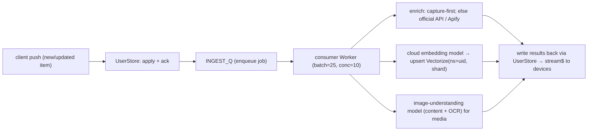

# Technical Plan — Monorepo, Cloud Backend & Cross-Platform Build

> **Status: execution plan.** This is the concrete "how" for the target state in
> [multiplatform-and-cloud.md](multiplatform-and-cloud.md). It assumes those decisions
> (extension = one-way capture; web + Expo mobile are the rich clients; all-Cloudflare backend;
> decoupled local/cloud embeddings; Firebase auth). Read that page first for the "why."

## Contents

1. [Platform capability confirmation (Expo)](#1-platform-capability-confirmation-expo)
2. [Monorepo layout & tooling](#2-monorepo-layout--tooling)
3. [Extraction sequence (keep the extension green)](#3-extraction-sequence-keep-the-extension-green)
4. [Cloud backend (Cloudflare)](#4-cloud-backend-cloudflare)
5. [The sync protocol](#5-the-sync-protocol)
6. [Web app (TanStack Start)](#6-web-app-tanstack-start)
7. [Mobile app (Expo)](#7-mobile-app-expo)
8. [Scalability & cost model — 100k users](#8-scalability--cost-model--100k-users)
9. [Observability, security, rate limiting](#9-observability-security-rate-limiting)
10. [Phased roadmap & milestones](#10-phased-roadmap--milestones)
11. [Risks & open items](#11-risks--open-items)

---

## 1. Platform capability confirmation (Expo)

Expo is the right choice; all three required capabilities exist (each needs a **custom dev build**
via EAS, not Expo Go — expected for a production app).

| Need | Mechanism | Caveat |
| --- | --- | --- |
| **Appear in the iOS/Android share sheet** ("share to Vibesearch") | `expo-share-intent` (URL/text/image/video/files, deep-links into the app on both OSes) or `expo-share-extension` (custom iOS share UI) | Config plugin + dev build; an **App Group** is needed on iOS to pass data to the app. |
| **Push notifications** | `expo-notifications` + Expo Push Service (over APNs/FCM) | Dev build required (Android SDK 53+); real hardware only. Since we already use Firebase, FCM credentials are at hand. |
| **Background sync** | `expo-background-task` (`BGTaskScheduler` iOS / `WorkManager` Android) + **silent push** to wake-and-sync | iOS background is **opportunistic**, not guaranteed real-time. Treat silent push as the trigger and background-task as a periodic safety net. |

> **Share-extension rule:** the extension target is memory-constrained. It must only **hand the
> shared URL/content to the app** (via the App Group / intent) and return; all fetching, embedding,
> and upload happen in the app's background task. (Matches the owner's note.)

---

## 2. Monorepo layout & tooling

**Tooling:** Bun workspaces + **Turborepo** (task graph, caching). Bun is already in use.

```
vibesearch/
├─ package.json                # { "workspaces": ["apps/*", "packages/*"] }
├─ turbo.json                  # pipeline: build, lint, test, typecheck
├─ tsconfig.base.json          # shared compiler options + path aliases
├─ packages/
│  ├─ search-core/             # PURE: query-language, hybrid-ranking, embedding-text, contracts
│  ├─ schemas/                 # item/folder/space/tag types + sync-field helpers (no RxDB dep)
│  ├─ api-client/              # typed fetch client for the cloud API (used by all clients)
│  ├─ sync-client/             # checkpoint/push/pull/stream state machine (no RxDB)
│  └─ ui-web/                  # shared DOM-React components (extension + web)
├─ apps/
│  ├─ extension/               # today's MV3 app; depends on search-core, schemas, ui-web, sync-client
│  ├─ web/                     # TanStack Start (Router + Query) — SSR on Cloudflare Workers, pure-server
│  ├─ mobile/                  # Expo / React Native
│  └─ api/                     # Cloudflare Workers (Hono) + Durable Objects + Queue consumers
└─ tooling/
   ├─ eslint-config/
   └─ tsconfig/
```

**Boundaries (the contract):**

- `search-core` and `schemas` stay **dependency-free** (no `chrome`, DOM, RxDB, fetch). They are
  imported by *every* app **and** the Worker — this is what guarantees identical query parsing and
  ranking everywhere.
- `api-client` and `sync-client` know HTTP/WebSocket but **not** the storage engine. Each app plugs
  in its own persistence (extension: RxDB; **web: none — pure server via TanStack Query**; mobile: SQLite via `@vs/sync-client` for offline).
- RxDB appears in **`apps/extension` only**.

**`turbo.json` (shape):**

```jsonc
{
  "tasks": {
    "build":     { "dependsOn": ["^build"], "outputs": ["dist/**"] },
    "typecheck": { "dependsOn": ["^build"] },
    "test":      { "dependsOn": ["^build"] },
    "lint":      {},
    "dev":       { "cache": false, "persistent": true }
  }
}
```

**TypeScript:** project references; packages publish types from `dist/` (tsc) or are consumed as
source via `tsconfig` path aliases. Path aliases live in `tsconfig.base.json` so every app resolves
`@vs/search-core` the same way.

**Bun + Expo/Metro caveat (real):** Expo's monorepo guidance is written for pnpm/npm/yarn. Bun
workspaces work, but Metro needs explicit monorepo config and occasionally trips on hoisting.
`apps/mobile/metro.config.js`:

```js
const { getDefaultConfig } = require("expo/metro-config");
const path = require("path");
const projectRoot = __dirname;
const workspaceRoot = path.resolve(projectRoot, "../..");
const config = getDefaultConfig(projectRoot);
config.watchFolders = [workspaceRoot];
config.resolver.nodeModulesPaths = [
  path.resolve(projectRoot, "node_modules"),
  path.resolve(workspaceRoot, "node_modules"),
];
config.resolver.disableHierarchicalLookup = true; // avoid duplicate-React issues
module.exports = config;
```

> If Bun + Metro friction shows up during the mobile phase, the fallback is pnpm for the whole
> monorepo — a contained, low-risk switch. Decide at the mobile milestone, not now.

---

## 3. Extraction sequence (keep the extension green)

Pure refactor; the extension must build and pass tests after **every** step.

1. **Scaffold workspace** — add root `package.json` workspaces + `turbo.json`; move the existing
   extension into `apps/extension/` unchanged. Verify `bun run build:chrome` still works.
2. **Lift `search-core` → `packages/search-core`** verbatim (it's already pure). Repoint imports via
   the `@vs/search-core` alias. Move its unit tests with it. `bun test` green.
3. **Lift schemas/types → `packages/schemas`.** Split the *types + sync-field helpers* from the
   RxDB `RxJsonSchema` objects: types go to `schemas` (shared), the RxDB schema wrappers stay in
   `apps/extension`. This is what frees web/mobile from RxDB while sharing the shape.
4. **Create `packages/api-client` + `packages/sync-client`** (new code, no behavior change to the
   extension yet — it isn't wired to the cloud until Phase 2).
5. **Extract reusable UI → `packages/ui-web`** opportunistically (only components web will reuse).
   Not blocking.
6. **CI**: one workflow runs `turbo run typecheck lint test build` across the graph; Turborepo
   caching keeps it fast.

Exit criterion: extension byte-for-byte equivalent in behavior, now consuming shared packages.

---

## 4. Cloud backend (Cloudflare)

`apps/api` is a Workers app (router: **Hono**). Bindings (`wrangler.toml`):

```toml
name = "vibesearch-api"
main = "src/index.ts"
compatibility_date = "2026-01-01"

[[durable_objects.bindings]]
name = "USER_DO"
class_name = "UserStore"

[[r2_buckets]]
binding = "MEDIA"
bucket_name = "vibesearch-media"

[[queues.producers]]
binding = "INGEST_Q"
queue = "ingest"

[[queues.consumers]]
queue = "ingest"
max_batch_size = 25
max_concurrency = 10          # bounds AI spend during bulk imports

# Vectorize: sharded — bound per shard (see §8). One example shown.
[[vectorize]]
binding = "VEC_00"
index_name = "vs-vectors-00"

[[kv_namespaces]]
binding = "CACHE"            # query-embedding cache, sessions, rate-limit counters
id = "…"

[[d1_databases]]
binding = "GLOBAL"          # cross-user: share registry, api-key hashes, shard map
database_name = "vibesearch-global"
```

### 4.1 Per-user Durable Object (`UserStore`) — the authoritative store

Each user gets one DO (`idFromName(firebaseUid)`). It owns that user's metadata in DO-SQLite and a
monotonic change log; blobs never live here.

```
UserStore (SQLite tables)
├─ items(id, doc JSON, updatedAt, deletedAt, seq)      -- seq = serverVersion, monotonic
├─ folders / spaces / tags ( … same shape )
├─ changes(seq INTEGER PRIMARY KEY AUTOINCREMENT, collection, id, op, updatedAt)
└─ meta(key, value)                                    -- e.g. lastSeq, schemaVersion
```

```ts
export class UserStore {
  // pull(sinceSeq) → ordered changes; push(changes) → LWW apply + new seqs;
  // WebSocket via Hibernation API for live fan-out to the user's other devices.
  async fetch(req: Request) { /* route /pull /push /stream */ }
  async webSocketMessage(ws: WebSocket, msg: string) { /* … */ }
}
```

- **WebSocket Hibernation API**: idle sockets are evicted from memory (no duration billing) and
  revived on message. This is the single most important cost decision — see [§8](#8-scalability--cost-model--100k-users).
- **FTS for cloud keyword/fuzzy search**: a `items_fts` FTS5 table (with `trigram` tokenizer for
  fuzzy/substring) inside the same DO. Per-user index, naturally sharded, no global search cluster.
- **DO-SQLite cap** is 10 GB/DO; since only text/metadata lives here (blobs → R2), a huge personal
  library is still well under it.

### 4.2 Vectorize — sharded, namespaced per user

- **Namespace = `firebaseUid`** → hard per-user isolation and fast filtering.
- **Shard across N indexes**: `indexFor(uid) = vs-vectors-${hash(uid) % N}`. The `uid → shard` map
  is recorded in D1 so it's stable even if `N` changes later.
- Sizing in [§8](#8-scalability--cost-model--100k-users). Empty indexes are ~free (billing is on
  stored/queried dimensions), so we start with generous `N` to avoid re-sharding.

### 4.3 R2 — media & documents

- Key layout: `u/<uid>/<itemId>/<sha256>.<ext>`. Content-addressed → **dedupe** identical blobs.
- Large files (videos, big PDFs) via multipart upload. Clients get presigned/Worker-proxied URLs.
- **No egress fees** is why multi-GB libraries are affordable (see §8).

### 4.4 Ingestion / enrichment pipeline (Queues)



`max_concurrency` + batching cap concurrent AI calls (the one variable cost). Idempotency by
`(itemId, contentHash)` so retries and re-imports don't double-spend.

### 4.5 Auth (Firebase ID tokens, verified in the Worker)

- Clients sign in via Firebase (Google/Apple/email) and send `Authorization: Bearer <idToken>`.
- The Worker verifies the RS256 JWT against Google's public certs (cached per `max-age` in KV),
  checking `iss`/`aud`/`exp`; `uid` becomes the DO name. Use
  `firebase-auth-cloudflare-workers` or equivalent — **stateless**, no session DB.
- **Device management**: a `devices` table (D1) keyed by `(uid, deviceId)`; **per-device revoke**
  adds the device to a denylist checked on stream connect and on refresh.

---

## 5. The sync protocol

One protocol, two postures (built on `seq`/`updatedAt`/`deletedAt`).

| Endpoint | Who | Purpose |
| --- | --- | --- |
| `POST /v1/sync/push` | extension (only this), web, mobile | apply local changes (LWW by `updatedAt`) → returns new checkpoint |
| `GET /v1/sync/pull?since=<seq>` | web, mobile | deltas since checkpoint (paginated) |
| `WS /v1/sync/stream` | web, mobile | live change events (hibernatable) |

```jsonc
// push request
{ "clientId": "uuid", "changes": [
  { "collection": "items", "id": "…", "doc": { /* schema doc */ },
    "updatedAt": 1730000000000, "deletedAt": 0 } ] }
// push / pull response
{ "checkpoint": 41872, "applied": 12, "conflicts": 0 }
```

- **Extension**: push-only. Never pulls (except the opt-in **≤10-item** offline cache, a separate
  capped `GET /v1/offline/pin`). On uninstall, local data is gone; the cloud copy is the backup.
- **Web/mobile**: push + pull + stream. **Mobile** persists an **offline outbox** (unsent changes)
  and drains it on reconnect; conflicts resolve LWW.
- **Conflict policy**: whole-doc last-writer-wins by `updatedAt`. (Rich-text concurrent-edit caveat
  tracked in [§11](#11-risks--open-items).)
- `sync-client` (shared package) implements the checkpoint loop and the outbox; each platform
  supplies a storage adapter.

---

## 6. Web app (TanStack Start)

- **Stack**: **TanStack Start** (TanStack Router + Query), SSR on Cloudflare Workers via
  `@cloudflare/vite-plugin` + `@tanstack/react-start`, reusing `@vs/ui-web` and `@vs/search-core`.
- **Data layer**: **pure server — no local persistence.** TanStack Query owns server-state
  (fetch + in-memory cache + invalidation); mutations call the API and refetch. **No IndexedDB**,
  and **no `@vs/sync-client` on web** (that's mobile-only, for offline).
- **Search**: calls `POST /v1/search`; the Worker parses with `query-language`, embeds the query
  (Qwen `@cf/qwen/qwen3-embedding-0.6b`, 1024-dim, cached in KV), queries Vectorize (ns=uid) + FTS,
  fuses with `hybrid-ranking`, paginates. Identical relevance to the extension's local path.
  update: no need to cache the query embeddings.
- **Rich content**: BlockNote → store structured JSON in `richContent` + a plaintext
  projection for embedding/search. PDFs/docs/video upload to R2 via the Worker.

---

## 7. Mobile app (Expo)

- **Stack**: Expo (dev client) + Expo Router + React Native; `@vs/search-core`, `@vs/schemas`,
  `@vs/api-client`, `@vs/sync-client` shared.
- **Local store / offline**: SQLite (`expo-sqlite`/`op-sqlite`) or Legend-State with SQLite
  persistence → supports **offline additions/edits**, drained via the sync outbox on reconnect.
- **Share-sheet quick-save**: `expo-share-intent` registers the share target; the extension hands
  the URL/content to the app through the App Group and returns immediately; a **background task**
  does the upload/enrich.
- **Push**: `expo-notifications` + Expo Push Service. **Silent (data) push** triggers a sync;
  visible push for share/activity nudges.
- **Background sync**: `expo-background-task` periodic drain as a safety net under push.

---

## 8. Scalability & cost model — 100k users

The goal: **compute + storage stay cheap to ~100k users with sizable data; AI is the accepted
variable cost.** The architecture is built around that split.

### Why compute stays near-flat

| Service | Scales with | Why it stays cheap | Lever |
| --- | --- | --- | --- |
| Workers (API/search) | requests | stateless, per-request priced, infinite horizontal scale | edge-cache hot reads/shares |
| **Durable Objects** | **concurrent active** users, not total | **WebSocket Hibernation** → idle users incur ~no duration cost; one DO/user = automatic sharding, no hot global table | hibernate sockets; batch writes |
| DO-SQLite | metadata size/user | text only (blobs in R2); 10 GB/DO headroom | keep blobs out of the DO |
| Queues | ingest events | per-op pricing; smooths bulk-import spikes | batch + `max_concurrency` |
| KV / Cache | reads | cheap reads; cache query embeddings & certs | TTL the query-embedding cache |

Because there is **no shared database** — each user is an isolated DO — there is no central bottleneck
to scale. 100k mostly-idle users cost roughly what their *active* sessions cost, not 100k × anything.

### Storage: the only linear cost — and it's the cheap kind

- **R2 has no egress fees.** For multi-GB-per-user media, bandwidth (usually the bill-killer) is
  free; you pay GB-month storage only. Content-addressed keys **dedupe** identical blobs; lifecycle
  rules + per-plan quotas cap growth. This is the single biggest reason the storage bill stays sane.
- DO-SQLite holds only text/metadata → small and cheap per user.

### Vectorize sizing (the sharding math)

Limits: **10M vectors/index**, **50k namespaces/index**, **50k indexes/account**.

```
100k users × ~1k vectors/user ≈ 100M vectors total
  • vector cap  → 100M / 10M  = ≥ 10 indexes
  • namespace cap → 100k / 50k = ≥ 2 indexes
  ⇒ start with N = 32 shards: ~3.1k users & ~3.1M vectors each — large headroom on both caps.
```

Empty/under-filled indexes are ~free (billing is on stored + queried dimensions), so a generous
`N=32` (or 64) avoids ever re-sharding within the foreseeable range — and even **1M users** stays
under the 50k-index cap with room to spare. Keep cloud embedding dims modest (≤768–1024) and avoid
over-chunking to keep stored-dimension cost down. *(Vector storage/query is "AI-adjacent" — it lands
in the variable bucket you've accepted, but these levers keep it controlled.)*

### Containing the AI bucket (accepted, but bounded)

Embed **once** on ingest (idempotent by content hash); **cache** query embeddings (KV/Cache); -> no need to cache the embeddings.
**batch** model calls; bound concurrency via the Queue; rate-limit the free tier. Image-understanding
runs once per media item, not per view.

> **Pricing note:** the above describes the cost *model* and the levers, not a dollar projection.
> Validate current rates with Cloudflare's pricing calculator before committing tiers — Cloudflare's
> per-service pricing changes over time.

---

## 9. Observability, security, rate limiting

- **Observability**: Workers Analytics Engine for request/latency, queue depth, **sync-lag** (client
  checkpoint vs. server `seq`); error tracking (Sentry); structured logs via Logpush.
- **Rate limiting**: per-uid + per-API-key counters in KV/DO (token bucket); stricter on free tier
  and on AI-triggering ingest. Public API keys are **scoped, hash-only** (the `vshr_owner_` pattern).
- **Security**: every sync/API/search route authenticated (Firebase token). Private-space data syncs
  up **only** into an existing cloud private space. Per-device revoke enforced on stream connect.
  Secrets (source API keys, Apify) in Workers Secrets.

---

## 10. Phased roadmap & milestones

| Phase | Deliverable | Done when |
| --- | --- | --- |
| **0. Monorepo** | Workspace + Turborepo; extension moved in | extension builds/tests unchanged in `apps/extension` |
| **1. Extract core** | `search-core`, `schemas`, `api-client`, `sync-client` packages | extension consumes packages; `bun test` green |
| **2. Cloud spine** | Worker API + `UserStore` DO + Firebase auth + push/pull/stream | extension does **one-way upload**; reinstall restores from cloud |
| **3. Vectors & search** | Vectorize shards + cloud embeddings + image-understanding + `/v1/search` | cloud hybrid search matches local relevance on a fixture set |
| **4. Web PWA** | `apps/web` rich client + rich-text + R2 uploads | sign in, see synced library, add rich content, search |
| **5. Mobile** | `apps/mobile` Expo: share-intent, push, background sync, offline outbox | share-to-app works; offline edits reconcile; push wakes sync |
| **6. Public API + ingestion** | OpenAPI + scoped keys; capture-first + Apify fallback | external token can CRUD + search; Reddit/X capture works |

Phases 0–2 are sequential and unlock everything. 3–5 can overlap once the spine is up.

---

## 11. Risks & open items

- **Rich-text concurrent edits** — whole-doc LWW can drop a concurrent edit. Acceptable given
  no real-time collaboration? If not, scope CRDT (Y.js) for `richContent` only. *(Confirm.)*
- **Cloud fuzzy quality** — FTS5 `trigram` covers substring/typo-ish; validate it meets the
  "fuzzy must work on web" bar, else add `spellfix1` or run the JS matcher server-side. *(Prototype in Phase 3.)*
- **Bun + Expo/Metro** — verify at Phase 5; pnpm is the contained fallback.
- **Re-sharding Vectorize** — avoided by starting at `N=32`; if ever needed, migrate per-user on next
  embed using the D1 shard map.
- **iOS background limits** — real-time depends on silent push landing; background-task is best-effort.
- **Storage quotas/tiers** — define free vs. paid caps before launch given multi-GB libraries.
- **Schema/API version lockstep** — version the wire contract; keep a compatibility window for
  un-updated mobile clients.
```
